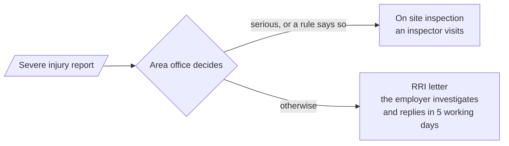
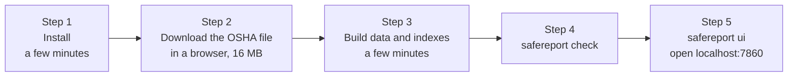
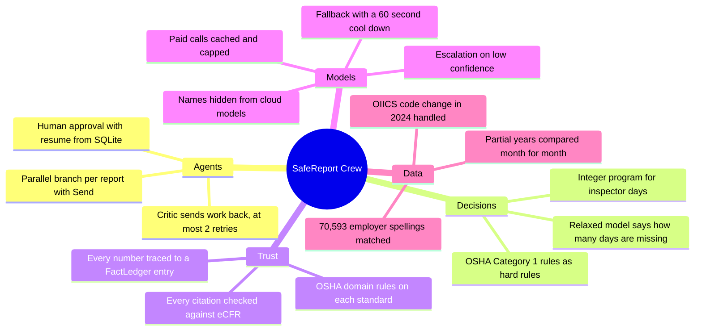
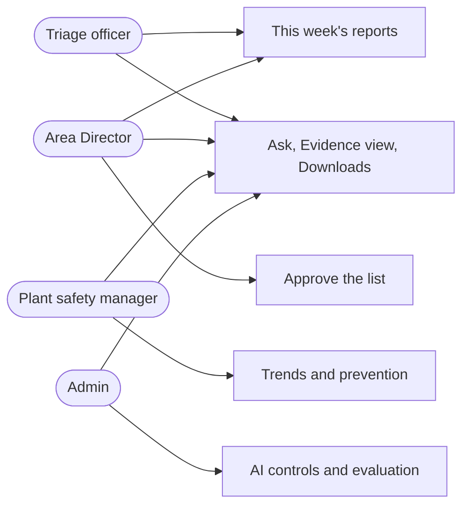
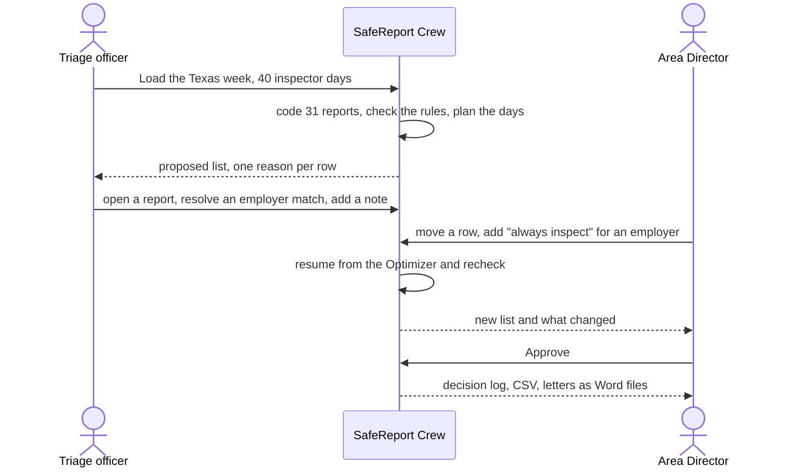
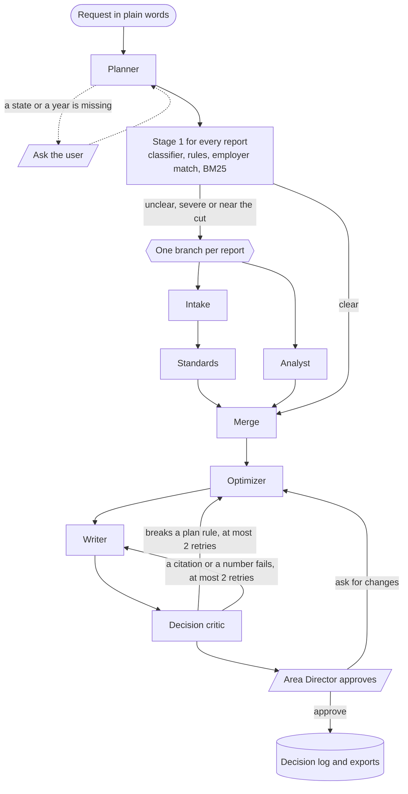
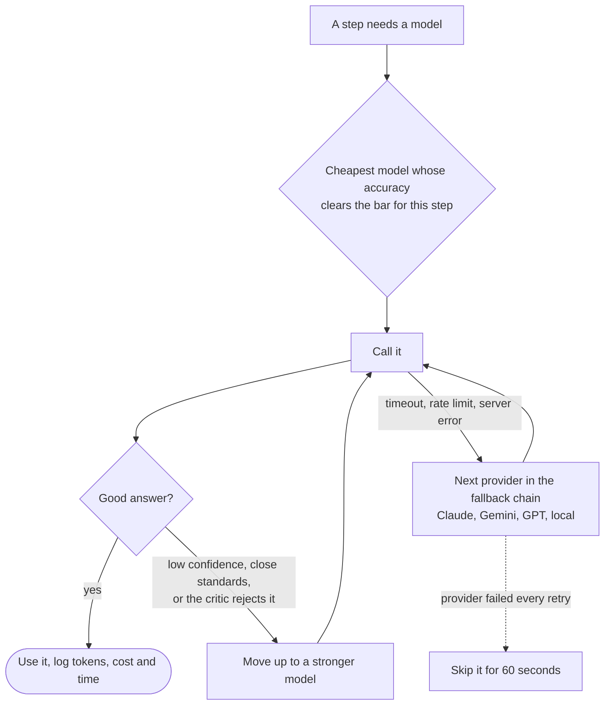
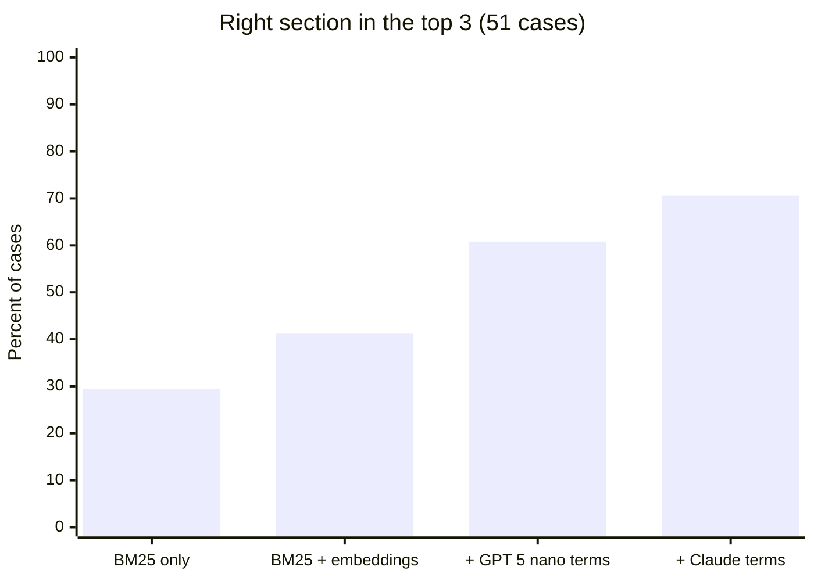

# SafeReport Crew

**A multi agent copilot that helps an OSHA area office decide, for each severe injury report,
whether to send an inspector or a letter, and helps a plant learn from injuries like its own.**

Final project for IE5374 Applied Generative AI, by **Seven Team-5374**: Quoc Hung Le (Kevin),
Hamad Al Sulaimi, Khoa Tran. Phases 0 to 3 of 4 are built; 307 tests pass offline.

| If you want to | Go to |
|---|---|
| run it in ten minutes, with no API key and no cost | [Quick start](#quick-start-for-a-ta) |
| see where each of the five course requirements is met | [Requirements map](#how-the-project-meets-the-five-requirements) |
| understand who it is for and what they need | [Users and their needs](#users-and-their-needs) |
| see how the agents work together | [How it works](#how-it-works) |
| check the measured results | [Results](#results) |
| read the full plan | [docs/PROPOSAL.md](docs/PROPOSAL.md) |

## The problem in one minute

When a worker in the US is hospitalized, loses a limb or loses an eye at work, the employer
must report it to OSHA, the federal workplace safety agency, within 24 hours. OSHA has
published **105,996** of these reports (January 2015 to November 2025). Each one is a short
story in free text, such as "an employee's hand was pulled into the rollers while clearing a jam".

For every report, an OSHA area office has to choose:



Only 33.5% of reports led to an inspection, because inspector days are scarce. Today staff read
every story, look up the employer's history by hand and search the regulations themselves.
SafeReport Crew does that reading, checking and planning, then hands a proposed list to a
person, who approves or changes it. **Nothing is sent without a person's approval.**

<details>
<summary><b>Words used in this README</b> (click to open)</summary>

| Word | Meaning |
|---|---|
| OSHA | the US Occupational Safety and Health Administration |
| Area office, Area Director | the local OSHA office and the person who signs off on its decisions |
| RRI letter | Rapid Response Investigation: a letter asking the employer to investigate and reply within five working days |
| Category 1 | OSHA's "must inspect" rules: two or more hospitalized, a worker under 18, a similar report from the employer within 12 months, a hazard under an emphasis program, imminent danger |
| Inspector day | one inspector working one day; in our assumptions an inspection takes 1.5 to 3 days by hazard ([config/triage.toml](config/triage.toml)) |
| 29 CFR 1910, eCFR | the general industry safety regulations, read from the official electronic Code of Federal Regulations |
| General Duty Clause | OSH Act Section 5(a)(1), used when no specific rule covers a hazard |
| OIICS | OSHA's codes for what happened (event), what caused it (source) and the injury |
| State Plan states | states that run their own safety program; most of their reports are not in this data |

</details>

## Quick start for a TA

Everything below runs **offline, with no API key and no cost.** The offline backend answers
every model step from fixed rules, so you see the full flow of agents, routing and checks.



**1. Install** (Python 3.11 to 3.13)

```bash
python3.12 -m venv .venv
```

```bash
source .venv/bin/activate
```

```bash
pip install -e ".[dev,embeddings]"
```

`embeddings` adds sentence transformers, torch and FAISS. Leave it out for a lighter install;
retrieval then runs on BM25 alone and the results are weaker.

**2. Download the reports.** OSHA's site blocks scripted downloads, so open
https://www.osha.gov/severe-injury-reports in a browser, click "Download the full SIR data set"
and put `January2015toNovember2025.zip` in `data/raw/`. Details in [data/raw/README.md](data/raw/README.md).

**3. Build the data and indexes** (the eCFR text comes from a public API with no key; the
embedding model downloads once)

```bash
safereport build-data && safereport fetch-ecfr && safereport build-index && safereport train-baseline
```

**4. Check that everything is ready**

```bash
safereport check
```

**5. Open the app**

```bash
safereport ui
```

Then go to http://localhost:7860. A five minute tour:

| Step | Do this | You should see |
|---|---|---|
| 1 | Keep "Triage officer", Texas, 40 inspector days, click **Load week** | 31 reports, 8 Category 1, 20 inspections and 11 RRI letters, with a reason on each row |
| 2 | Click any row | the case inspector: the story with highlighted words, the checks, the employer's history, the letter as it will be sent |
| 3 | Pick "Area Director" at the top, move a row in the decision bar, click **Ask for changes** | "Plan updated with N changed rows" and what changed |
| 4 | Click **Approve**, then **Approve** again | the first click warns that employer matches are still unanswered (a confirmed match can make a report Category 1); the second resumes the run from its saved state and logs the decision |
| 5 | Open **Ask** and try an example | the answer beside a trace of agents, models, reasons, cost and time |
| 6 | Pick "Plant safety manager", open **Trends and prevention**, write a lockout talk with Vietnamese as the extra language | a yearly chart, a state map, and two Word files (English and Vietnamese) |
| 7 | Pick "Admin", simulate an outage of Claude, ask again | the router falls back to another model and says why |

The same crew runs from the command line:

```bash
safereport ask "Plan this week's inspections with 40 inspector days." --answer state=Texas --approve
```

### What costs money

The default is offline: without `--live`, no model is called at all.

| Command | Who answers | Cost |
|---|---|---|
| `safereport ui`, `safereport ask "..."`, `pytest`, every build command | offline rules, no model | **free** |
| `safereport ui --live --mode private`, `safereport ask "..." --live --mode private` | only Gemma 4 E4B in LM Studio on this machine; cloud keys are not loaded | **free** |
| `--live` with `lowest_cost` or `best_quality` (and API keys in `.env`) | Claude, GPT 5 nano, Gemini, Gemma | **paid**; every reply is cached and all paid calls stop at the team's cap of $1.50 |

The first line of every `ask` run says which it is, for example
`Models answering live: gemma_local (local, free)`. For the free local path, start the LM Studio
server with `google/gemma-4-e4b` loaded (default address `http://localhost:1234/v1`, or set
`LM_STUDIO_URL`); if it is not running, the run says so and the offline rules answer. Keys are
read from `.env` (never committed): `ANTHROPIC_API_KEY`, `OPENAI_API_KEY`, `GOOGLE_API_KEY`.

## How the project meets the five requirements

The course asks for five things. Each row says where it lives in the code and how to see it.

| Requirement | What we built | Where in the code | See it |
|---|---|---|---|
| **1. Handles open ended queries** | users ask in their own words; the Planner splits a request into sub tasks with dependencies and asks back when a state or a year is missing | `graph.py` (Planner node), `providers.py` | Ask tab; `safereport ask "Plan this week's inspections with 40 inspector days."` asks "Which state should I look at?" |
| **2. Multi agent architecture** | seven agents on LangGraph with distinct roles: reasoning (Planner, Intake, Standards, Analyst), optimization (Optimizer), decision making (Decision critic), generation (Writer) | `graph.py`, `triage.py`, `domain.py`, `writer.py` | the trace under every answer |
| **3. Interactive user interface** | a Gradio app with a view per role: the week's list beside a case inspector, editable rows, approval with resume, charts, maps, CSV and Word downloads | `app.py`, `views.py` | `safereport ui` |
| **4. Three or more LLMs with routing** | Claude Sonnet 5.5, GPT 5 nano, Gemini 3.5 Flash and local Gemma 4 E4B; the router picks by step, accuracy bar, confidence and cost, and falls back across providers | `router.py`, `config/models.toml`, `backends.py` | Admin page: routing mode, simulated outage, model calls log, Pareto chart |
| **5. Scalability and adaptability** | each agent is a node; models, prices and triage weights live in config; DuckDB on Parquet over 105,996 reports; indexes chosen by industry; new months added as files | `data.py`, `retrieval.py`, `config/` | swap a model in `config/models.toml`, no code change |

### Beyond the baseline



## Users and their needs

Four roles, each opening on its own page. The main user is the triage officer; the plant
safety manager is a secondary user.



| User | Need | What answers it | Status |
|---|---|---|---|
| Triage officer | **N1** each report coded with its severity, in seconds | stage 1 coding with a confidence threshold | built |
| | **N2** the employer's history across all its spellings (Walmart alone has 340) | employer matching and the matches panel | built |
| | **N3** the rule that applies, with the words that support it | Standards agent and Evidence view | built |
| | **N4** OSHA's Category 1 check, with the criterion that triggered it | Category 1 rules | built |
| | **N5** an RRI letter that asks for the facts the story leaves out | missing facts list and the Writer | built |
| | **N6** a whole week at once | two stage batch | built |
| Area Director | **N7** a proposed list with a reason on every row | the Optimizer | built |
| | **N8** change any row or rule and see the new list | editable list, resume from saved state | built |
| | **N9** what one more or one fewer inspector day changes | inspector day chart | built |
| | **N10** a record of each decision and who made it | decision log | built |
| Plant safety manager | **N11** injuries in plants like theirs, and the trend | trends with charts and maps | built |
| | **N12** the rules for those hazards in plain words | plain language summaries | built |
| | **N13** what to fix first within the budget | prevention plan | phase 4 |
| | **N14** a shift safety talk in English and, if needed, one of Spanish, Chinese, Tagalog, Vietnamese or Arabic | Writer and Word export | built |
| Admin | **N15** control what each model sees and what it costs | AI controls page, cost log | built |

A day for the area office, end to end:



## How it works



| Agent | Kind | What it does |
|---|---|---|
| **Planner** | reasoning | splits the request into sub tasks, asks for missing details, sends each report of a week down its own branch |
| **Intake** | reasoning | reads the story: activity, machine, injury, severity, event code with a confidence, and the facts it leaves out |
| **Standards** | reasoning with retrieval | searches the regulations (BM25 plus embeddings) with terms a model writes in the language of the rules, and cites the section and paragraph |
| **Analyst** | reasoning over data | DuckDB queries, similar past injuries, employer history, trends and charts |
| **Optimizer** | optimization | OSHA's Category 1 rules first, then an integer program (PuLP) that spends the inspector days left; when there are too few days, a relaxed model says how many more are needed |
| **Writer** | generation | inspection briefs, RRI letters, safety talks, answers; every number is a placeholder filled from a FactLedger |
| **Decision critic** | decision making | checks every citation against eCFR, the OSHA domain rules, every number and the plan rules, and sends work back |

**Why two stages?** Three model calls per report would be about 85 calls for one Texas week and
over 500 nationwide. Stage 1 codes every report without a model in seconds; only the reports
that need it go to the model branches (20 of 31 in the Texas week).

### How the router picks a model



Three routing modes: **Lowest cost**, **Best quality**, and **Private**, which keeps every step on
the local model (start the app in it with `safereport ui --live --mode private`). In the other two, a redaction step replaces employer names, addresses and
people's names with placeholders before any call to a cloud model.

### What keeps the answers safe

* **No citation without the official text.** The critic checks each section against eCFR and
  OSHA domain rules (a jam cleared on a running machine needs 1910.147; 1910.217 only for
  mechanical power presses; 1910.178 only for powered industrial trucks). On the Texas week it
  corrected 12 standards before the list was shown.
* **No number without a source.** The Writer puts placeholders, and only numbers the tools
  recorded fill them.
* **No trend on unequal periods.** The data ends in November 2025, so 2025 is compared with the
  same eleven months of earlier years: a plain yearly count shows a 3.6% fall, the fair
  comparison a 4.5% rise.
* **A person decides.** The graph stops for approval, and every decision is logged with its
  reason and approver.
* **A spending cap.** Paid calls are cached and stop at $1.50 in total.

## The app, page by page

The app follows the plain style of OSHA's Severe Injury Dashboard (blue menu, serif headings,
outcome figures, record tables) and uses no official government mark.

| Page | Who | What is on it |
|---|---|---|
| **This week's reports** | Triage officer, Area Director | totals at the top; the list on the left with filters (All, Category 1, Needs review, Inspection, RRI letter) and a CSV of the selection; a case inspector on the right; the decision bar (move rows, flag an imminent danger, notes, an always inspect rule, Ask for changes, Approve); a map of the week beside the top five events; the inspector day chart; the employer matches panel; a closed routing and audit log |
| **Ask** | everyone | chat beside the trace, an inline chart, the brief as a Word file |
| **Evidence view** | everyone | the story with the words the Intake agent used, beside the cited rule, its checks and the employer's history |
| **Trends and prevention** | Plant safety manager | outcome figures, a yearly chart of four outcomes over the same months, a state map that marks State Plan states, the top five events, the safety talk |
| **AI controls and evaluation** | Admin | routing mode, redaction, a simulated outage per provider, the model table, the evaluation tables, the Pareto chart of cost against accuracy, every model call |
| **Downloads** | everyone | the list as CSV; briefs, letters, summary and talks as Word files |

Sign in is off by default and the role is picked at the top. Set `SAFEREPORT_PASSWORD` to
require it, with the accounts `triage`, `director`, `manager` and `admin`.

**Languages.** The office works in English: OSHA's reports, the regulations and the letters are
in English, and the Evidence view highlights the story by character position, which translation
would break. Only the safety talk, read aloud to a crew, comes in one more language, chosen from
the five most spoken at home after English in the 2025 American Community Survey (table B16001,
as summarized by [Access Multilingual](https://accessmultilingual.com/resources/languages-spoken-in-the-united-states-census-2024)):
Spanish, Chinese, Tagalog, Vietnamese and Arabic. The translations were drafted with an AI
assistant and need a native speaker's review before a plant uses them.

## Results

The test set is our **answer key of 60 manufacturing reports** (51 with a standard, 9 under the
General Duty Clause), labelled with a written guide ([docs/LABELING_GUIDE.md](docs/LABELING_GUIDE.md))
and reviewed by all three of us. It is a final test set: no prompt, weight or threshold was tuned
on it, and every rate has a 95% Wilson interval, because one case moves a rate by about 2 points.

**Does a model help find the right regulation?** Share of the 51 cases where the right section
is in the top 3 (strict):



| Top 3, strict | Hits of 51 | Rate (95% interval) | Gained / lost against no model | Exact McNemar p |
|---|---|---|---|---|
| No model (BM25 plus embeddings) | 21 | 41.2% (28.8 to 54.8) | | |
| GPT 5 nano writes the search terms | 31 | 60.8% (47.1 to 73.0) | 13 / 3 | 0.021 |
| Claude Sonnet 5.5 writes the search terms | 36 | 70.6% (57.0 to 81.3) | 16 / 1 | 0.0003 |

* Claude puts the right section first in 26 cases (51.0%), against 12 without a model.
* Claude against GPT 5 nano: 7 gained, 2 lost (p 0.18), so 51 cases do not settle which is better.
* The whole experiment cost $0.14 of the $1.50 cap. Gemini 3.5 Flash returned server errors for
  most calls on 19 November 2026 and was not scored.

**Event coding without a model** (TF IDF and logistic regression, 1,000 held out 2025 reports):
59.6% on the full code, 78.7% on the two digit group, 90.7% on the one digit division. Coding
only when the confidence is at least 0.7 covers 51% of reports, 80% of them right.

**Employer matching:** of 150 hand checked name pairs, the "same" rule held for 100 of 100 and
45 of 50 "possible" pairs were one employer, so possible matches wait for a person.

All numbers are in [eval/results](eval/results). Reproduce them without any paid call:

```bash
safereport eval-baselines
```

```bash
safereport live-summary
```

**OSHA changed its event codes in January 2024** (OIICS 2 to OIICS 3; group 64 means "caught in
machinery" before and "struck by a falling object" after). So the coder is trained on OIICS 3
reports, the data layer refuses an event code filter across January 2024, and older reports get
an estimated OIICS 3 code, marked as estimated on every chart.

## Repository map

```text
src/safereport/
  graph.py         the seven agents as a LangGraph graph, interrupts, checkpoints
  router.py        model choice, escalation, fallback, cool down
  providers.py     Anthropic, OpenAI, Google and LM Studio adapters
  offline.py       the offline backend used without keys and in tests
  triage.py        Category 1 rules and the inspector day integer program
  domain.py        OSHA domain checks used by the critic
  retrieval.py     BM25, FAISS and the index registry (Part 1910, Part 1926 when built)
  data.py          DuckDB over Parquet, filters that respect the 2024 code change
  employers.py     employer matching and saved match decisions
  redaction.py     names and addresses hidden from cloud models
  writer.py        templates for briefs, letters, talks and answers
  spend.py         reply cache and the $1.50 cap
  app.py, views.py the Gradio app
config/            models.toml (models, prices, router), triage.toml (weights, days)
data/labels/       the answer key and the three reviewers' files
eval/results/      every measured number
docs/              proposal, labelling guide, related products, open issues, AI use
tests/             307 tests, offline, no keys
```

## For developers

```bash
pytest -q
```

```bash
ruff check . && ruff format --check .
```

| Command | What it does |
|---|---|
| `safereport build-data` | writes `data/processed/reports.parquet` with a `split` column: train (2015 to 2024), holdout (the 1,000 2025 reports in `data/splits/holdout_2025.csv`), recent (other 2025) |
| `safereport fetch-ecfr` | downloads Part 1910 from the eCFR API |
| `safereport build-index` | indexes Part 1910, the General Duty Clause and 12 emphasis programs with BM25 and `BAAI/bge-small-en-v1.5` in FAISS |
| `safereport train-baseline` | trains the event coder and writes an OIICS 3 code for every report |
| `safereport employer-pairs` | scores the hand check of employer matching |
| `safereport eval-live --model claude --smoke 3` | **paid:** format check on reports outside the key |
| `safereport eval-live --model claude --score` | **paid:** one scored run over the key, cached and capped |
| `python scripts/merge_labels.py` | rebuilds `data/labels/answer_key.csv` from the three label files |

Tests that need the built data skip when it is missing, so the suite also runs on a fresh clone,
as in CI (`.github/workflows/ci.yml`, started by hand for now). Triage weights and inspector days
per inspection are in [config/triage.toml](config/triage.toml).

## Limits

* Most State Plan states are missing from the data, and only reported injuries appear.
* 2025 covers January to November only; trends compare the same months.
* Without a model, the cited standard is the top retrieval result, right for about 41% of the
  key, so offline letters need a person's check.
* OSHA's past inspection choices reflect its own staffing; they are a reference, not proof.
* The reports cannot be linked to the citations OSHA issued (the inspection numbers do not match).
* Inspector days per inspection are assumptions, shown as values you can change.
* The week map plans no travel; one state stands in for one office's territory. Map tiles come
  from CARTO and OpenStreetMap, so the browser needs the internet for them.
* Phase 4 is next: router accuracies measured outside the key, a seeded domain check set, the
  inspection AUC, batch savings, the router on the Pareto chart, and the prevention plan.

More in [docs/OPEN_ISSUES.md](docs/OPEN_ISSUES.md); how we used AI tools is in
[docs/AI_USAGE.md](docs/AI_USAGE.md); related products are compared in
[docs/RELATED_PRODUCTS.md](docs/RELATED_PRODUCTS.md).

## License

MIT, Seven Team-5374. Not an official U.S. government website or product.
