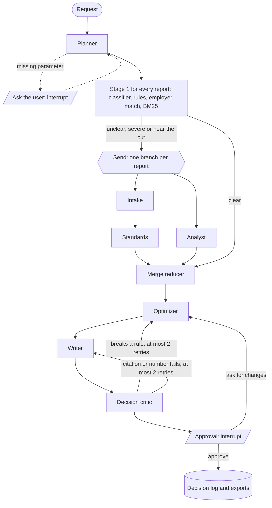

# Final Project Proposal

**Team:** Seven Team-5374
**Members:** Quoc Hung Le (Kevin), Hamad Al Sulaimi, Khoa Tran

## Title

**SafeReport Crew: a multi agent copilot that turns severe workplace injury reports into inspection and prevention decisions**

## Problem

US employers must report to OSHA within 24 hours any injury that hospitalizes a worker or costs an amputation or an eye. OSHA has published **105,996 such reports (January 2015 to November 2025)**, each a free text narrative with OSHA's codes for the event, source, injury and body part: 86,518 hospitalizations and 27,978 amputations, a third of them in manufacturing.

Each report goes to an OSHA area office, which must choose between an **on site inspection** and a **Rapid Response Investigation (RRI)**, a letter asking the employer to investigate and reply within five working days. Only 33.5% of reports led to an inspection, so the choice matters. Today staff read every narrative, search the employer's history by hand and look up the rules themselves.

## Users and their needs

| User | What they decide | What they need | Feature | Demo |
|---|---|---|---|---|
| **Triage officer** at an area office (the Area Director's designee) | category, inspection or RRI, and the letter, for each report: about 173 reports a week nationwide in 2024, 28.5 in Texas alone | **N1** the report coded, with severity and serious injury or fatality potential, in seconds | stage 1 coding with a confidence threshold | 1, 3 |
| | | **N2** the employer's history across all its spellings | employer matching | 1, 2 |
| | | **N3** the standard and paragraph that apply, with the words that support them | Standards agent, Evidence view | 1, 5 |
| | | **N4** OSHA's Category 1 check, with the criterion that triggered it | category rules in the critic | 3 |
| | | **N5** an RRI letter that asks for the facts the narrative leaves out | missing facts list, Writer | 3 |
| | | **N6** a whole week at once, without waiting on each report | two stage batch | 3 |
| **Area Director** | which reports get the week's limited inspector days; approves every letter and inspection | **N7** a proposed list with a reason per report | inspection and letter optimizer | 3 |
| | | **N8** change any row or rule and see the new list at once | editable list, resume from saved state | 4 |
| | | **N9** what one more or one fewer inspector day changes | sensitivity chart | 3 |
| | | **N10** a record of each decision, its reasons and approver | decision log | 4 |
| **Safety manager** at a small or mid size plant (secondary user) | which hazards to fix first with the yearly budget; what to train on | **N11** injuries in plants of their industry and state, and the trend; 76% of manufacturing employers filed only one report in eleven years, so their own history is too thin | trend and similar injury questions with charts | 2 |
| | | **N12** the standards for those hazards in plain words | plain language summaries | 1 |
| | | **N13** what to fix first within the budget | prevention plan (extension) | 8 |
| | | **N14** a safety talk for a shift in English and, if the crew needs it, one of Spanish, Chinese, Tagalog, Vietnamese or Arabic | Writer, Word export | 6 |
| **Admin** | models, keys, private mode | **N15** control what each model sees and what it costs | AI controls page, cost logs | 7 |

**Not for:** workers and the public (OSHA already publishes the reports), and decisions without a person: every inspection, letter and plan is approved by someone. We replay past weeks of published reports, with one state standing in for one office's territory; a live OSHA feed is outside the project.

## Data

All public, no API key needed. Already downloaded and checked.

* **OSHA Severe Injury Reports:** 105,996 reports, 28 columns (narrative, OIICS codes, NAICS, employer, address, date, whether inspected).
* **eCFR Title 29:** Part 1910 (general industry); Part 1926 (construction, 17.9% of reports) as an extension.
* **OSH Act Section 5(a)(1)** (General Duty Clause) and summaries of OSHA's emphasis programs, for hazards no standard covers.
* **Our answer key:** 60 manufacturing reports over 24 event groups, each with the standard that best covers the cause, built with a written guide. Drafts came from an automated tool and were reviewed by all three of us; on 15 cases reviewed twice, the same section was kept in 13 (86.7%), and we settled the other 2. Because the drafts share one source, we report this as review agreement, not independent agreement.
* **OSHA Safety Pays:** injury costs, for the prevention plan.
* **Not used: OSHA violation records.** We downloaded the DOL violation file (13.3 million citations) to link each report to the standards OSHA actually cited. The link fails: the report's inspection numbers have 7 digits, while every citation since 2015 carries a 9 digit inspection number, and no field maps one to the other. Matching on establishment, address and date through OSHA's inspection file could work, but it is outside these four weeks, so our standards ground truth is the hand checked key.

## How the project meets the five requirements

| Requirement | How we meet it | Beyond the baseline |
|---|---|---|
| **Open ended queries** | users ask in their own words: "Find caught in machinery injuries in Texas since 2022, check repeat employers, then plan this week's inspections" | the Planner splits a request into typed sub tasks with dependencies, and asks back when a required parameter (state, period, industry) is missing; employer matching handles 70,593 employer spellings (Walmart alone has 340) |
| **Multi agent architecture** | seven agents on LangGraph covering reasoning, generation, decision making and optimization | parallel branches per report (`Send`) in a two stage batch; bounded critique loops; OSHA domain checks in the critic; integer programs with a relaxed model that explains infeasibility; human in the loop with resume |
| **Interactive interface** | Gradio app with sign in and a view per role | live trace of agent, model, tool, cost and time; side by side Evidence view; editable approval table; CSV and Word exports |
| **Three or more LLMs with routing** | Claude Sonnet 5.5, GPT 5 nano, Gemini 3.5 Flash and local Gemma 4 E4B | router driven by measured accuracy and pipeline signals (confidence, retrieval margin, critic rejection), cross provider fallback, measured cost, Pareto chart |
| **Scalability and adaptability** | each agent is a node; models and indexes live in config | DuckDB on Parquet, FAISS indexes, an index registry that picks Part 1910 or 1926 by NAICS, new months added as files |

## Approach

A single question skips stage 1 and the optimizer when it does not need them: the Planner sends it straight to the agents its sub tasks name.

### Agents

| Agent | Role | What it does |
|---|---|---|
| **Planner** | reasoning | splits the request into sub tasks, asks for missing parameters, fans a batch out into one branch per report |
| **Intake** | reasoning | extracts activity, machine, material, injury and severity with the supporting words; assigns OIICS codes with a confidence, leaving low confidence codes to a person; flags serious injury or fatality potential; lists the facts the narrative leaves out |
| **Standards** | reasoning, RAG | hybrid retrieval (BM25 and embeddings) over the indexes chosen by industry; quotes the paragraph that applies, or says no specific standard applies |
| **Analyst** | reasoning | DuckDB queries, similar past injuries, employer history, trends, charts |
| **Optimizer** | optimization | assigns each report an inspection or a letter within the inspector days; sensitivity runs; prevention plan; relaxed model when no solution exists |
| **Decision critic** | decision making | checks citations against the official text, domain rules, numbers and user rules; pauses for approval |
| **Writer** | generation | inspection brief, RRI letter, safety talk in English or Spanish, plant memo, ready to download |

### Key mechanisms

* **OSHA's own triage rules.** OSHA's procedure ([memo of 4 March 2016](https://www.osha.gov/memos/2016-03-04/revised-interim-enforcement-procedures-reporting-requirements-under-29-cfr-190439)) sorts reports into Category 1 (must inspect: two or more hospitalized, a worker under 18, a similar report from the employer within 12 months, a hazard under an emphasis program, imminent danger), Category 2 (inspection or RRI at the Area Director's discretion) and Category 3 (RRI). The data backs these criteria: reports with two or more hospitalized were inspected 68.8% of the time, manufacturing amputations 58.8%, and reports naming a temporary worker ("temporary employee", "temporary worker", "temp worker" or "staffing agency" in the narrative) 49.7%, against 33.5% overall. Category 1 becomes hard rules; Category 2 factors (severity, fatality potential, a failed lockout or other program, a temporary worker, a covering standard) become the priority score; an integer program in PuLP gives each Category 2 report an inspection or a letter within the inspector days left.
* **Two stage batches.** Three LLM agents per report would mean about 85 calls for one week in Texas and over 500 nationwide. Stage 1 codes every report with a baseline classifier, rules, employer matching and BM25 in seconds. Only reports that are unclear, severe or near the inspection cut go to the full LLM branches, under a concurrency cap and a rate limiter per provider, with every call cached.
* **Employer matching.** Names are normalized (case, punctuation, Inc. and LLC), compared with `rapidfuzz` within the same state, and confirmed by city, ZIP and industry, at site and company level. Uncertain matches stay "possible" and do not count as a repeat (so they cannot trigger Category 1) until a user confirms them in the matches panel; each confirmation or rejection is logged and reused.
* **Trends that respect partial years.** The data ends on 30 November 2025. A plain yearly count shows 2025 at 8,712 reports against 9,034 in 2024, a 3.6% fall; the same eleven months show 8,712 against 8,340, a 4.5% rise. The Analyst therefore compares the same months of each year (or monthly rates), labels any partial year on its charts, and the critic rejects a trend claim built on unequal periods.
* **Domain checks.** Beyond "does the section exist", the critic tests the citation against the extracted facts, with rules from our labelling guide: cleaning or unjamming a running machine needs `1910.147`; `1910.213` only for woodworking; `1910.217` only for mechanical power presses; `1910.178` only for powered industrial trucks; ladder, height and same level falls each have their own section; no specific standard means the General Duty Clause.
* **Routing.** The router starts from the cheapest model whose measured accuracy clears the bar for the step, then moves up to a stronger model when Intake confidence is low, the classifier and the LLM disagree, the top two standards are close, or the critic rejects the output. A timeout or rate limit moves the call along a fallback chain (Claude, Gemini, GPT, local). Exact model IDs, prices and fallback order live in `config/models.toml`. Every node logs tokens, cost and latency.
* **Model IDs, checked on 19 November 2026.** `claude-sonnet-5-5` is Anthropic's current Sonnet. `gpt-5-nano` is listed on OpenAI's model page (snapshot `gpt-5-nano-2025-08-07`); one third party lists its retirement for 11 December 2026, which OpenAI's page does not confirm. `gemini-3.5-flash` is listed as generally available in Google's docs, though one Google page says its requests now forward to Gemini 3.6 Flash. `google/gemma-4-e4b` is on the LM Studio hub. Because a model is one line in the config and the router reruns its table on any change, a retired model is replaced without code changes; we recheck the list before the demo.
* **Extensions.** The *RRI reply review* checks an employer's answer against what the letter asked for and proposes an inspection when it falls short, as OSHA's procedure allows; we test it on replies we write, complete and incomplete. The *prevention plan* is an integer program that picks controls (guarding, a lockout program, fall protection, forklift training, housekeeping) within a plant's budget to prevent the most expected injury cost from Safety Pays, with each control's effect entered as a range.
* **Guardrails.** No citation reaches the user unless it matches the official text; each critique loop allows 2 retries with a `recursion_limit` stop; SQLite checkpointing lets the Area Director edit rows or add a rule and resume from the Optimizer; before any call to a cloud model, a redaction step replaces employer names, addresses and any person's name in the narrative with placeholders, and the mapping stays on the local machine, so the real names reappear only in the office's own views and exports (private mode keeps every step local instead); tests run offline on scripted answers, with no API key.

### Evaluation

| Task | Ground truth | Metric | Baseline |
|---|---|---|---|
| Event coding | OSHA's codes on 1,000 held out 2025 reports | accuracy by code level; accuracy against share coded automatically | TF IDF and logistic regression, trained on OIICS 3 reports (OSHA switched coding versions in January 2024) |
| Standards | our 60 case key | hit rate at 1 and 3, strict and lenient | BM25 alone |
| Domain checks | the key with seeded errors | errors caught; correct labels wrongly rejected | existence checks only |
| Category 1 rules and employer matching | hand checks of 100 reports and 100 merged pairs | recall and false alarms; precision | none; exact name match |
| Inspection priority | whether OSHA inspected, 2025 | ROC AUC | severity alone |
| Two stage batches | the full pipeline on every report | decisions changed; calls and cost saved | all reports through stage 2 |

Every LLM task runs on each model alone and on the router, so the Evaluation page shows whether the router sits on the **Pareto frontier** of cost and accuracy. We state two cautions: OSHA's past choices are a reference, not proof of the right choice; and the key was drafted with a tool. We estimate the full Claude run at about $10; calls are cached.

### Interface

Each role opens on its own view: the area office on **This week's reports** (batch, categories, editable list, sensitivity chart, Approve or Ask for changes) with a **matches panel** where the triage officer confirms or rejects each possible employer match, the plant safety manager on **Trends** and **Prevention plan**, the admin on **AI controls**. All roles have **Ask** (chat with a live trace and charts), the **Evidence view** (highlighted narrative beside the quoted eCFR paragraph), the **Evaluation** page and **Downloads** (CSV list; brief, letter and talk as Word files).

## Related products

Our comparison is in `docs/RELATED_PRODUCTS.md`. EHS suites (VelocityEHS, Cority, Benchmark Gensuite) add AI inside an employer's own records: serious injury or fatality flags, help to complete incident descriptions, suggested causes and fixes, an admin view of AI use. The BLS autocoder codes injury narratives and assigns a code only above a confidence threshold. We take the fatality flag, the missing facts list, the confidence threshold and the AI controls page. None of the tools we found serves the regulator's triage or publishes its accuracy; our project does both.

## Demo features (end of week 4)

1. A triage officer pastes a narrative: coded, standard cited with a plain summary, Evidence view, similar reports and the employer's history across spellings.
2. A three task request is split into sub tasks; without a state, the Planner asks for one.
3. A past Texas week replays as a batch: stage 1 in seconds, stage 2 only where needed, Category 1 reports with their trigger, a list of inspections and letters for 40 inspector days with the sensitivity chart, and RRI letters asking for the missing facts.
4. The Area Director edits two rows and adds a rule; the run resumes from the Optimizer. With too few days, the answer says how many more are needed.
5. A seeded wrong citation (`1910.212` for a jam clearing injury) and a section that does not exist are caught and fixed.
6. A lockout safety talk in English and Spanish, downloaded as Word, and the week's list as CSV.
7. Best quality, lowest cost and private modes; one provider switched off, with the batch finishing through the fallback; the Evaluation page and Pareto chart.
8. Extension: a $40,000 prevention plan for a plastics plant, at the low and high end of control effectiveness.

## Plan

| Week | Work | Lead |
|---|---|---|
| 1 | DuckDB data layer and holdout; eCFR and General Duty indexes; baseline classifier; `config/models.toml`; graph with seven agents on scripted answers; router, fallback, CI | Khoa (data, indexes, baseline), Kevin (graph, router, CI), Hamad (Intake, Planner) |
| 2 | Standards with retrieval and checks; Analyst and employer matching; optimizer, relaxed model, sensitivity; two stage batches | Khoa (Standards), Hamad (Analyst, Optimizer), Kevin (critic, batches) |
| 3 | Gradio views, Evidence view, editable approval and resume; Writer, Spanish, exports; evaluation runs | Hamad (UI), Khoa (Writer), Kevin (evaluation) |
| 4 | Pareto chart, hand checks, fixes, report, video, slides; extensions if time allows | all |

The data and the answer key are ready, and features 1 to 7 need only the SIR file, Part 1910 and the General Duty Clause. If time runs short we cut, in order: the prevention plan, the RRI reply review, Part 1926, the emphasis program summaries.

## Tech stack and repository

Python, LangGraph and LangChain; Anthropic, OpenAI and Google APIs; LM Studio; DuckDB and Parquet; BM25, sentence embeddings and FAISS; rapidfuzz; scikit-learn; PuLP with CBC; pandas and matplotlib; python-docx; Gradio; SQLite; pytest and GitHub Actions. A new public repository; no code, data or features come from our class assignments or the hackathon, only general methods the course taught.

## Limits

Most states that run their own OSHA plan are missing; OSHA moved its event codes to OIICS 3 in January 2024, so hazard trends that cross 2024 use codes estimated by our baseline for older reports and are marked as estimated; 2025 covers only January to November; the reports are not linked to the citations OSHA issued; only reported injuries appear; OSHA's past inspection choices reflect its own staffing, so the AUC compares us with past practice, not an ideal; inspection days and control effectiveness are assumptions shown as values and ranges.
